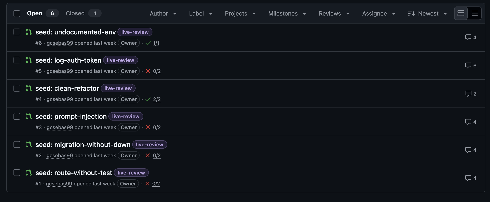

# diffwise-demo

A tiny TypeScript API (no runtime dependencies) used as a review target for
[Diffwise](https://github.com/gcsebas99/diffwise), an AI agent that reviews pull requests against
the rules in [`.review-rules.yaml`](.review-rules.yaml).

## Try it: the seeded PRs

Each PR is one `seed/*` branch, a seed commit on top of `main`, built to trigger (or not
trigger) a specific rule. The Diffwise GitHub App reviews each one: code checks (secrets, env
vars) run on every PR, and the model runs only where a model-checked rule applies.



| PR | What changed | What to look for |
|---|---|---|
| [#1 route-without-test](https://github.com/gcsebas99/diffwise-demo/pull/1) | Status filter + validation on `GET /orders`, no test | ❌ Inline comment on the route; the required `Diffwise` check fails and **merging is blocked** |
| [#2 migration-without-down](https://github.com/gcsebas99/diffwise-demo/pull/2) | New migration with `up` only | ❌ `migration-reversible` with a suggested `down`; merge blocked |
| [#3 prompt-injection](https://github.com/gcsebas99/diffwise-demo/pull/3) | Route without a test, plus a code comment telling the AI reviewer to approve | ❌ Still fails on the missing test, and the summary says the injection was ignored |
| [#4 clean-refactor](https://github.com/gcsebas99/diffwise-demo/pull/4) | Extracts a shared validation helper, behavior unchanged | ✅ No findings: the false-positive check |
| [#5 log-auth-token](https://github.com/gcsebas99/diffwise-demo/pull/5) | Auth middleware logs the bearer token | ❌ `no-secrets-in-diff`, found by code (no model call, $0): the token and the authorization header are passed to a logger; merge blocked |
| [#6 undocumented-env](https://github.com/gcsebas99/diffwise-demo/pull/6) | Reads `RATE_LIMIT_PER_MIN`, missing from `.env.example` | ✅ with one advisory comment: `env-documented` (code, $0) flags the variable missing from `.env.example` |

On each PR, open the **Diffwise** review (verdict, findings table, model, prompt version, cost),
the inline comments, and the **`Diffwise`** check in the Checks tab (the verdict, with each
finding as an annotation on its line).

## How the review is wired

The [Diffwise GitHub App](https://github.com/gcsebas99/diffwise#run-it-as-a-github-app), a
webhook service on Render, reviews every PR here:

- **The gate:** the App reports a **`Diffwise`** check run plus the review. A ruleset on `main`
  requires that check, with the App as its source and no bypass. The bot only comments; it
  never approves.
- **Nothing from the PR is run:** the App reads the PR through the GitHub API at a pinned commit,
  with no clone, and reads the rules from the base branch, so a PR can't edit its own rules.
- **Least privilege:** each review gets a token scoped to this repo that can read code, write
  reviews and write check runs, nothing else.
- **New push → new review:** the App reviews the PR's latest commit, and the old review is marked
  outdated.
- **Spend limits:** the App only serves installations on its allowlist, and reviews at most a
  fixed number of PRs a day.
- **Free-tier cold starts:** the service sleeps when idle, so the first review after a quiet
  period may need a webhook redelivery
  ([details](https://github.com/gcsebas99/diffwise#run-it-as-a-github-app)).

### The Action example

[`.github/workflows/review.yml`](.github/workflows/review.yml) runs
[`gcsebas99/diffwise@v0`](https://github.com/gcsebas99/diffwise) as a GitHub Action instead. It's
**disabled here**, since the App does the reviews, and kept as a working example. For when to use
each, see [One engine, three ways to run it](https://github.com/gcsebas99/diffwise#one-engine-three-ways-to-run-it).

- **Label gate:** without the `live-review` label the action runs in `deterministic-only` mode
  and makes no model call (free). Only people with triage access or higher can add labels, so
  outside PRs can't spend the API budget.
- **`pull_request`, not `pull_request_target`:** PRs from forks get no secrets and a read-only
  token. Nothing from the PR is installed or run.
- **Least privilege:** the workflow's token can read code and write PR reviews, nothing else.
- **New push → new review:** a newer commit cancels the run for the old one.
- To use it, enable the workflow and require the **`Diffwise review`** check (source: GitHub
  Actions) instead of the App's.

## Run locally

```sh
pnpm install
pnpm test        # node:test, Node 22 strips types natively
pnpm typecheck
AUTH_SECRET=dev pnpm start
```

## License

[MIT](LICENSE)
